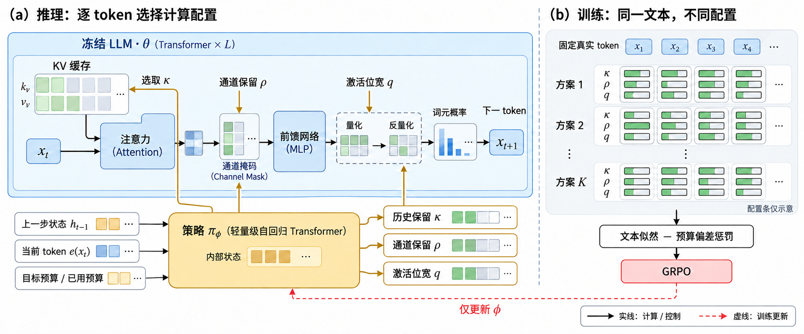

# 默认研究方法示意图风格

用户确认将下图的视觉风格用于后续论文精读。绘制前实际查看参考图片；可向支持本地参考图的制图工具提供该图片，并明确要求只借鉴视觉风格。图片随技能保存，不依赖聊天历史或临时路径。

参考图是《Compute Where it Counts: Self Optimizing Language Models》的阅读用简化示意。后续复用其视觉表达，具体模块、连接、符号和训练机制必须来自当前论文；不能将该图中的冻结模型、策略控制器或GRPO套用到其他论文。

## 版式与对象

- 白底、紧凑的论文插图风格。优先采用便于横向阅读的整体构图；需要展示两个互补机制时，用 `(a)`、`(b)` 分区及简短中文标题。主机制占主要空间，局部细节占较小空间，分区之间可用细虚线隔开。
- 分区取决于方法：整体与局部、两个协作分支、前后表示变化等均可。只有论文确有必要时才拆成“训练／推理”。参考图约为2.4:1，比例仅供参考，不能为保持比例压缩文字或遗漏关键分支。
- 用具有含义的图形表达研究对象：token用小块序列，特征用小矩阵，缓存用成组单元，选择用保留与灰化单元，概率用简短柱形；模型用有清楚边界的模块，多个相关模块用浅色区域分组。选择论文实际需要的对象，不机械填满所有图形类型。
- 使用细边框、小圆角、留白和对齐；浅色填充可带很轻的渐变。避免厚重阴影、立体装饰和海报式大色块。主线清楚，图例和辅助标签不抢占机制展示区域。

## 配色与连接

优先沿用以下柔和配色；可为当前论文微调，但同一种颜色在一张图中含义一致。

| 视觉角色 | 建议颜色 | 使用方式 |
| --- | --- | --- |
| 基础模型、常规模块及输入token | 浅蓝 `#DCEAF7`，边框蓝 `#52789B` | 建立方法的基础结构；是否冻结另用文字或符号标明 |
| 本文新增机制或核心可学习组件 | 浅金 `#F9E8AC`，边框金 `#A8802C` | 突出真正创新的位置，不将所有可训练模块都标成创新 |
| 特征、缓存及保留的单元 | 浅绿 `#DDEEDB`，边框绿 `#6D9270` | 配合具体小块、矩阵或选择示意 |
| 被屏蔽或未选择的单元 | 浅灰 `#ECEFF2` | 仅在方法确有掩码、裁剪或选择时使用 |
| 正文与主要数据连接 | 深色 `#202831` | 细实线、有明确箭头方向 |
| 控制连接 | 金色 `#A8802C` | 有实际控制关系时使用，箭头落在受控操作上 |
| 训练或参数更新连接 | 红色 `#D92D35` | 使用虚线，只指向确实被更新的参数或模块 |

数据、控制与更新有多种连接时，给出简短图例；实际不存在的连接类型无需添加。绕线尽量短，避免穿过文字和矩阵。不能为排版方便改变箭头的起止对象，也不能把控制关系画成数据流。

## 文字与说明

- 中文短标签为主，保留必要英文术语、缩写与数学符号；分区标题加粗，模块名清楚，辅助说明较轻。标签尽量一至两行，长解释写在图下正文。
- 数学变量与正文含义一致，注意上下标、希腊字母和中文字体可读性。生成后逐一查看文字，修正乱码、错字、重叠和错误符号。
- 少量token、矩阵或配置条可以帮助说明机制，但教学构造应在图内或紧邻图注明“示意”。不得把示意条长、概率或数字伪装成实验结果。
- 图注给出依据的原图号或章节，并注明“阅读用简化示意”；关键简化在图注或正文解释。参考图中的具体内容无需沿用。

## 绘制与交付

先从当前论文整理输入、输出、核心模块、表示变化和连接语义，再按上述风格构图。使用图像生成时，可采用以下提示骨架，并填入当前论文的真实内容：

> 参考随附图片的学术方法图风格：白底，紧凑分区，浅蓝基础模块、浅金核心创新、浅绿特征或缓存、浅灰未选单元，细边框与必要箭头，中文短标签，使用token块与小矩阵呈现具体对象。按照以下已核实的模块和连接绘制研究方法示意图：〔当前论文的对象、连接、分区与符号〕。图形结构以这些内容为准，参考图片只提供视觉风格。完整显示全部内容，保证笔记宽度下文字可读。

输出清晰PNG或SVG，保存为Obsidian库内附件并嵌入正文，路径遵循SKILL.md。绘制后查看整张成图，核对模块与箭头含义，确认无裁切、乱码或重叠，并检查在笔记正常宽度下仍能读清。过密时调整分区、简化次要内容或增加必要的局部示意，不用无限缩小字体来容纳内容。不得用通用Mermaid流程图代替这一默认风格。
